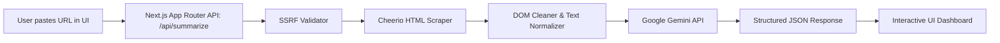

# ScrapePulse AI ⚡ Full-Stack AI Web Scraper & Summarizer

[](https://nextjs.org/)
[](https://www.typescriptlang.org/)
[](https://aistudio.google.com/)
[](https://cheerio.js.org/)
[](LICENSE)

> A modern full-stack web application that extracts readable content from any webpage URL, removes web clutter with Cheerio, and synthesizes structured executive summaries using Google's free Gemini AI API.

---

## 🌟 Features

- **Instant URL Scraping**: Extracts readable text from any blog, news article, or documentation page with Cheerio.
- **Clutter & Boilerplate Removal**: Strips navigation menus, headers, footers, advertisement blocks, cookie banners, and script tags to isolate core content.
- **SSRF Attack Protection**: Validates target URLs and strictly blocks private, loopback, and local network IPs (e.g., `localhost`, `127.0.0.1`, `10.0.0.0/8`, `192.168.0.0/16`, AWS/GCP metadata endpoints).
- **Google Gemini AI Synthesis**: Generates:
  - **Executive TL;DR**: 1-sentence punchy summary
  - **Key Insights & Takeaways**: Actionable numbered takeaways
  - **Narrative Report**: Formatted markdown summary with headings and bullet points
  - **Topic Tags**: Category tags extracted from the content
- **Multi-Model Fallback Engine**: Seamlessly tries candidate Gemini models (`gemini-3.5-flash-lite`, `gemini-3.8-flash`, `gemini-3.7-flash`) with automatic failover during temporary peak traffic.
- **Multiple Summary Modes**:
  - `Comprehensive`: Balanced overview with narrative flow
  - `Key Takeaways`: Laser-focused bullet points and facts
  - `Executive TL;DR`: Succinct briefing for decision makers
  - `Deep Dive`: In-depth analytical breakdown
- **Rich Dashboard & Metrics**:
  - Original word count vs. summarized word count
  - Estimated reading time saved (e.g. 5m read condensed to 1m)
  - Percentage condensed (e.g. 94% shorter)
- **Scraped Raw Text Inspector**: Inspect the raw extracted text before AI processing to verify scraper accuracy.
- **One-Click Actions**: Copy plain text, copy Markdown, or export summary to `.txt`.
- **Search History**: Automatically caches recent summaries in `localStorage` for instant recall.
- **Custom Key Override**: Visitors can optionally provide their own free Gemini API key directly through the settings dialog.

---

## 🏗️ Architecture & Tech Stack



- **Frontend**: Next.js 16 (React 19, TypeScript), Tailwind CSS, Lucide Icons, React Markdown
- **Backend API**: Next.js Serverless Route Handlers (`/api/summarize`, `/api/health`)
- **Scraping Engine**: Cheerio for server-side DOM parsing and HTML sanitization
- **AI Integration**: Google Gemini API via `@google/genai` with JSON structured schema output

---

## 🚀 Quick Start (Local Setup)

### Prerequisites

- **Node.js**: v20.11 or higher
- **npm**: v10+ (or pnpm / yarn)
- **Google Gemini API Key**: Free tier key from [Google AI Studio](https://aistudio.google.com/app/apikey)

---

### Step 1: Clone the Repository

```bash
git clone https://github.com/yashk230/ai-web-scraper.git
cd ai-web-scraper
```

### Step 2: Install Dependencies

```bash
npm install
```

### Step 3: Configure Environment Variables (.env)

Create a file named `.env.local` in the root of the project directory (alongside `package.json`):

```bash
# Windows (PowerShell)
Copy-Item .env.example .env.local

# macOS / Linux
cp .env.example .env.local
```

Open `.env.local` and insert your Gemini API Key:

```env
# .env.local
GEMINI_API_KEY=AIzaSyYourActualGeminiApiKeyHere
```

> **Where do I get a free API Key?**
> 1. Visit [Google AI Studio](https://aistudio.google.com/app/apikey).
> 2. Click **Create API Key**.
> 3. Copy the key and paste it as `GEMINI_API_KEY` in `.env.local`.
> 4. Google provides a generous free tier with no credit card required!

> **Security Note:**
> `.env.local` is listed in `.gitignore` and will never be committed to git.

---

### Step 4: Run Locally

Start the development server:

```bash
npm run dev
```

Or build and run the optimized production bundle:

```bash
npm run build
npm run start
```

Open your browser at:
```
http://localhost:3000
```

---

## 📡 API Endpoint Reference

### `POST /api/summarize`

Receives a webpage URL, scrapes its HTML content, and returns an AI summary.

#### Request Body

```json
{
  "url": "https://en.wikipedia.org/wiki/Web_scraping",
  "mode": "comprehensive",
  "customApiKey": "optional_override_key"
}
```

| Parameter | Type | Required | Description |
|-----------|------|----------|-------------|
| `url` | string | **Yes** | Target webpage URL (HTTP/HTTPS) |
| `mode` | string | No | `'comprehensive'`, `'bullet-points'`, `'executive'`, `'deep-dive'` (default: `'comprehensive'`) |
| `customApiKey` | string | No | Optional Gemini API key override |

#### Response (`200 OK`)

```json
{
  "success": true,
  "data": {
    "url": "https://en.wikipedia.org/wiki/Web_scraping",
    "title": "Web scraping - Wikipedia",
    "description": "Overview of web scraping techniques and history",
    "siteName": "wikipedia.org",
    "favicon": "https://en.wikipedia.org/static/favicon/wikipedia.ico",
    "tldr": "Web scraping is the automated extraction of data from websites for research and analysis.",
    "keyTakeaways": [
      "Extensively used for price monitoring, market research, and machine learning datasets.",
      "Involves fetching HTML over HTTP or simulating headless browser environments.",
      "Subject to legal considerations such as terms of service and robots.txt protocols."
    ],
    "summary": "### Introduction\nWeb scraping refers to extracting data...",
    "topics": ["Web Scraping", "Data Mining", "Automation"],
    "stats": {
      "originalWordCount": 3802,
      "originalCharCount": 25000,
      "originalReadTime": 19,
      "summaryWordCount": 253,
      "summaryReadTime": 1,
      "reductionPercentage": 94
    },
    "scrapedTextPreview": "Web scraping, web harvesting, or web data extraction...",
    "scrapedAt": "2026-10-13T17:26:37.000Z",
    "modelUsed": "gemini-3.5-flash-lite",
    "mode": "comprehensive"
  }
}
```

---

### `GET /api/health`

Health check endpoint to verify backend status and API key readiness.

```json
{
  "status": "ok",
  "hasServerKey": true,
  "timestamp": "2026-10-13T17:25:52.411Z"
}
```

---

## 🚢 Deployment Guide

### Deploying to Vercel (Recommended)

Because ScrapePulse AI is built as a single unified Next.js application, both the frontend and backend API endpoints deploy together effortlessly with zero server configuration.

#### Option A: 1-Click Git Import
1. Push this repository to GitHub.
2. Go to [Vercel](https://vercel.com/) and click **Add New Project**.
3. Import your `ai-web-scraper` repository.
4. In the **Environment Variables** section, add:
   - **Key**: `GEMINI_API_KEY`
   - **Value**: `Your_Google_Gemini_API_Key`
5. Click **Deploy**. Vercel will build and launch your application globally!

#### Option B: Deploy via Vercel CLI
```bash
npx vercel
```
When prompted for environment variables, add `GEMINI_API_KEY`.

---

## 🛡️ Security & Reliability Features

1. **SSRF Mitigation**:
   Requests to loopback (`127.0.0.1`), LAN subnets (`192.168.0.0/16`, `10.0.0.0/8`, `172.16.0.0/12`), or cloud metadata endpoints (`169.254.169.254`, `metadata.google.internal`) are blocked at the validator layer before any socket connection is attempted.
2. **Safe Timeout Budget**:
   External web requests use an `AbortController` timeout of 15 seconds to prevent serverless execution hangs on unresponsive sites.
3. **Payload Truncation**:
   Excessive HTML documents are capped at 25,000 characters to ensure fast AI processing while capturing the complete core narrative.
4. **Fallback Models**:
   Automatically cascades from `gemini-3.5-flash-lite` to `gemini-3.8-flash` and `gemini-3.7-flash` if temporary load spikes occur on Google's free tier.

---

## 📄 License

This project is licensed under the [MIT License](LICENSE).
